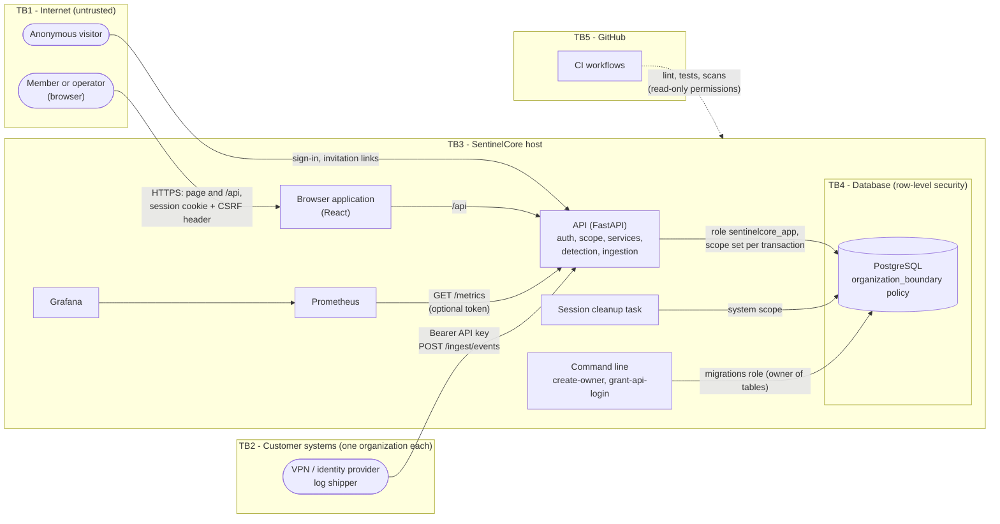
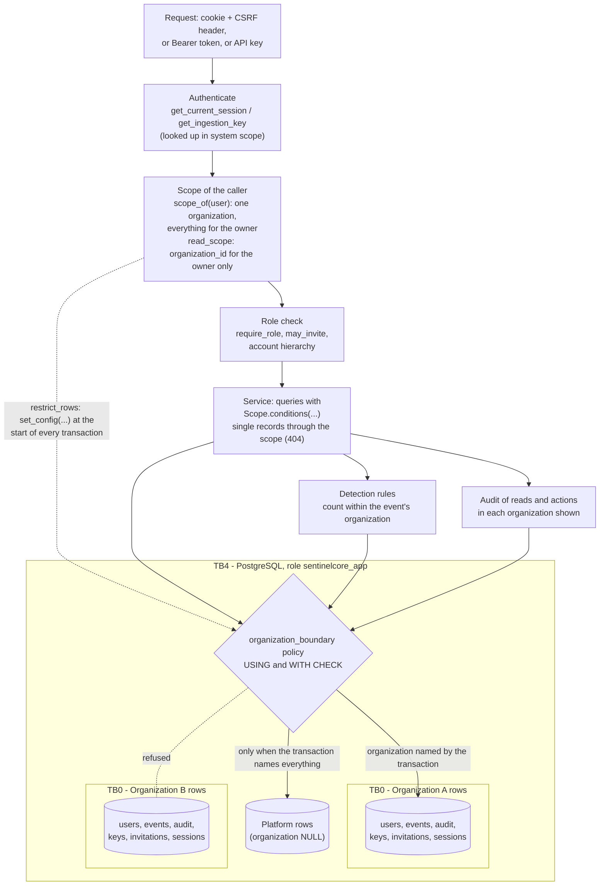

# SentinelCore - Threat Model (STRIDE)

This document lists what can go wrong with SentinelCore, who could make it happen, what already stops it, and what is left. The boundary between organizations is the main trust boundary and gets the closest analysis.

- **Version:** 2026-10-13, on `main` after the five multi-organization pull requests (#29 to #33).
- **Scope:** the system as it runs today: the browser application, the API with ingestion, PostgreSQL with row-level security, the session cleanup task, the command line, the simulator and `make demo`, local monitoring (Prometheus, Grafana) and the GitHub workflows. Containers, Kubernetes, the supply chain and cloud infrastructure (phases B to E of the roadmap) are out of scope; each phase adds its own section here.
- **Updates:** a change that adds an element, a data flow or a trust boundary updates this document in the same pull request.

---

## 1. Method

1. **Data flow diagrams** (section 5), at two levels: the system with its external actors, then the path of one request. Trust boundaries are drawn where the level of trust changes.
2. **STRIDE per element** (section 6): each element is checked against the six categories that apply to it.

   | Letter | Category | Property it breaks |
   |---|---|---|
   | S | Spoofing | Authentication |
   | T | Tampering | Integrity |
   | R | Repudiation | Non-repudiation |
   | I | Information disclosure | Confidentiality |
   | D | Denial of service | Availability |
   | E | Elevation of privilege | Authorization |

3. **Each threat** has an id (`T-01`...), a scenario, the attacker profiles that could carry it out (section 3), the mitigation in the code and the test that proves it, the MITRE ATT&CK technique where one fits, and a residual risk.
4. **Residual risk** is qualitative: the likelihood that the threat succeeds despite the mitigations, and its impact if it does, each low, medium or high, combined as follows. There is no numeric scoring such as DREAD or CVSS: both claim a precision a model of this size does not have.

   | Likelihood \ Impact | Low | Medium | High |
   |---|---|---|---|
   | **Low** | Low | Low | Medium |
   | **Medium** | Low | Medium | High |
   | **High** | Medium | High | High |

5. **Status:**
   - **Mitigated:** the mitigation exists and a test proves it.
   - **Partly mitigated:** the mitigation covers part of the threat, or exists without a test.
   - **Accepted:** a known limit, documented and kept on purpose for now.
   - **Open:** nothing stops it yet.

   A mitigation without a test is written as *untested*.
6. **Gaps** are documented here, not fixed in the same change. Section 8 lists the most important residual risks.

---

## 2. Assets

| Id | Asset | Why it matters |
|---|---|---|
| A1 | Credentials: passwords, sessions, JWTs, CSRF tokens | Whoever holds them acts as the account. |
| A2 | Secrets issued once: API keys, invitation tokens | A key writes into an organization's detection pipeline; an invitation creates an account. |
| A3 | Each organization's records: accounts, security events, audit log, invitations, API keys | Confidential to that organization. |
| A4 | The integrity of the security events and the audit log | Investigations and accountability rely on them. |
| A5 | Detection: the rules, their alerts and the threat level | A silent miss leaves an attack unseen; a false alert wastes the operators' time. |
| A6 | Availability of sign-in, ingestion and the console | Operators must reach the console during an incident. |
| A7 | Server-side secrets: `SECRET_KEY`, database credentials, `METRICS_TOKEN` | They unlock every other asset. |

---

## 3. Attacker profiles

| Id | Profile | Starts with |
|---|---|---|
| P1 | Anonymous attacker on the internet | Network access to the login, invitation and ingestion endpoints. |
| P2 | Malicious member of another organization | A valid account in organization B, aiming at organization A. **The main profile for the trust boundary between organizations.** |
| P3 | Compromised member account | The credentials or session of a user, analyst or admin, in their own organization. |
| P4 | Stolen ingestion key or compromised customer system | A valid API key of one organization. |
| P5 | Access to the host or the database | A shell on the machine, or database credentials. |
| P6 | Compromised dependency or CI action | Code that runs during the build or inside the application. Sketched only; phase C covers it. |

---

## 4. Trust assumptions

These are trusted by design. They are stated rather than modelled, each with what follows if it fails and what reduces the damage today.

| Id | Assumption | If it fails | What reduces the damage today |
|---|---|---|---|
| TA1 | **The platform owner is trustworthy.** One owner, created from the command line, may read and act in every organization. | A compromised owner account reads every organization's records, creates admins anywhere, suspends organizations and issues API keys. | Every read by the owner of an organization's records is audited in that organization (`audit_read` in `app/services/audit_service.py`; `test_the_owners_listing_is_audited_in_each_organization_it_showed`, `test_an_organizations_audit_log_shows_the_owner_reading_it`). Granting a privileged role raises a T1098 alert (`test_granting_a_role_that_reaches_every_account_is_flagged`). The owner cannot be locked or changed by other operators (`test_owner_role_restrictions_leave_target_unchanged`). Separating the owner's powers is a separate project. |
| TA2 | **The owner of the tables is trusted.** The migrations' role (`sentinelcore`, a superuser in the Docker image) bypasses row-level security and may change any row. | It can rewrite or delete security events and audit records without trace. | The API never signs in as it: it uses `sentinelcore_app`, which may only add to the history (`test_the_api_cannot_rewrite_history`), and readiness fails if the API's role could bypass the policies (`test_readiness_fails_when_the_api_could_bypass_row_security`). The table owner's credentials are used only by migrations and by `make demo`. There is no tamper evidence on the history yet (T-45). |
| TA3 | **The host is the user's own machine.** PostgreSQL, Prometheus, Grafana and the backend listen on `127.0.0.1`; the development credentials in `docker-compose.yml` and `.env.example` are public. | Anyone on the host reads the database and the demo's password files. | Services bound to the loopback interface; demo passwords in files of mode 600 (`test_the_admins_passwords_are_written_for_the_user_alone`). Production hosting is phase B. |
| TA4 | **Outside development, the application is served over HTTPS**, behind a proxy that sets the client address correctly. | Cookies travel in clear text; logged addresses are wrong. | `AUTH_COOKIE_SECURE` marks the cookies `Secure` (`test_cookie_secure_flag_follows_settings`); the client address comes from the connection only, not from headers, unless uvicorn is told to trust a proxy (`get_client_ip` in `app/api/deps.py`). |

---

## 5. Data flow diagrams

### 5.1 Level 0: the system and its actors

| Boundary | Between | What crosses it |
|---|---|---|
| TB1 | The internet and the host | Sign-in, invitation acceptance, every console request. |
| TB2 | A customer's systems and the host | Ingested events, authenticated by an API key of that organization. |
| TB3 | The host's processes | Requests reach the API only through its HTTP interface. |
| TB4 | The API and the data | Every query runs as `sentinelcore_app`, under the policy of the organization the transaction names. |
| TB5 | GitHub and the code | CI reads the code and reports; it deploys nothing. |
| **TB0** | **One organization and another** | Drawn in 5.2: it runs through every layer, from the API's scope to the database's policy. |

### 5.2 Level 1: one request, and the boundary between organizations

A member's request is limited twice: by the conditions the service adds to every query, and by the policy PostgreSQL applies to every row. Either one alone keeps organization B's rows out; tests remove the application's filter on purpose to show that the database still holds the boundary (`test_the_database_holds_the_boundary_when_a_listing_forgets_it`, `test_the_database_holds_the_boundary_when_a_lookup_forgets_it`).

---

## 6. Threats per element

Backend tests are in `backend/tests/`, frontend tests next to the code they test (`*.test.ts(x)`). Risk is likelihood / impact → residual.

### E1. Browser application

| Id | STRIDE | Threat | Who | Mitigation | Evidence | MITRE | Risk | Status |
|---|---|---|---|---|---|---|---|---|
| T-01 | S, E | Script injected into the page (XSS) steals the session or acts as the user. | P1, P3 | React escapes all output and no code writes raw HTML; the session cookie is `httpOnly`, so a script cannot read it. There is no Content Security Policy, so an injected script could still act within the page. | `test_browser_login_sets_hardened_cookies_and_no_token_in_body`; no CSP (*untested*) | T1185 | L / H → Medium | Partly mitigated |
| T-02 | T | Another site makes the browser send a state-changing request (CSRF), or signs the user into the attacker's account (login CSRF). | P1 | Signed double-submit CSRF token bound to the session (`csrf_token_for`, `app/api/deps.py`); cookies `SameSite=Strict`; browser login accepts JSON only. | `test_cookie_requests_that_change_state_require_a_valid_csrf_token`, `test_csrf_cookie_is_bound_to_the_session`, `test_browser_login_rejects_non_json_bodies` | - | L / M → Low | Mitigated |
| T-03 | T | The console is framed by another site and an operator is tricked into clicking an action (clickjacking). | P1 | No `X-Frame-Options` or `frame-ancestors` is sent. Destructive actions need a confirmation step, and suspension needs the slug typed, which makes a blind click harder. | *untested* | - | M / M → Medium | Open |
| T-04 | S | After sign-in, `?next=` sends the user to a look-alike site (open redirect). | P1 | Only application paths are followed (`features/auth/redirect.ts`). | `redirect.test.ts`, `LoginPage.test.tsx` "ignores a next parameter pointing to another site" | T1566 | L / M → Low | Mitigated |
| T-05 | I | An invitation token leaks through server logs, `Referer` or browser history. | P1, P5 | The link carries the token in the fragment, never sent to a server; the page clears it from the address and sends it in the request body. | `invitation-link.test.ts`, `AcceptInvitationPage.test.tsx` "sends the token in the body and clears it from the address" | - | L / M → Low | Mitigated |
| T-06 | T | A linked page rewrites the console's tab (reverse tabnabbing). | P1 | External links open with `rel="noopener noreferrer"` (`MitreBadge.tsx`). | `OrgEventsPage.test.tsx` "marks detections with their MITRE ATT&CK technique and links it from the details" | - | L / L → Low | Mitigated |
| T-07 | I | A new API key or invitation link stays in the browser after it was shown. | P3, P5 | Shown once from component state; never in the address, storage or query cache (`gcTime: 0`). It stays on screen while the panel is open, and in the clipboard after copying. | `OrgApiKeysPage.test.tsx` "lets the owner create a key, shows it once, and keeps it nowhere else" | - | L / M → Low | Accepted |
| T-08 | E | The interface offers an action the user may not take, and that is taken as permission. | P3 | The API decides every permission; the interface only mirrors it (`features/org/permissions.ts`). | `test_change_user_role_without_owner_returns_403`, `test_only_the_owner_issues_and_revokes_keys` | - | L / L → Low | Mitigated |

### E2. API: authentication and sessions

| Id | STRIDE | Threat | Who | Mitigation | Evidence | MITRE | Risk | Status |
|---|---|---|---|---|---|---|---|---|
| T-09 | S | Guessing one account's password (brute force). | P1 | After a number of failures in a window, sign-in for that email is locked for a while and an incident is raised (`login_protection_service.py`); the lock counts only this application's own failures. | `test_threshold_failure_locks_login_and_records_incident`, `test_locked_login_rejects_correct_password_without_checking_it`, `test_reported_failures_never_lock_this_application` | T1110.001 | L / H → Medium | Mitigated |
| T-10 | S | One common password tried on many accounts (password spray). | P1 | Detection only, by design: failures for many emails from one address raise an alert (`detect_password_spray`). Slow and distributed sprays stay below the rule; the evaluation measures it (`docs/evaluation/report.md`, 0 of 10 caught). | `test_failures_for_many_emails_from_one_address_raise_a_spray_incident`, evaluation report | T1110.003 | M / M → Medium | Partly mitigated |
| T-11 | I | Learning which emails have accounts from sign-in answers or their timing (enumeration). | P1 | One answer for a wrong password and an unknown email, and a password hash verified in both cases; unknown emails are locked like real ones; "account inactive" only after the right password. | `test_login_unknown_email_returns_401_and_still_verifies_a_hash`, `test_unknown_email_is_locked_like_an_existing_one`, `test_there_is_no_public_sign_up` | T1589.002 | L / L → Low | Mitigated |
| T-12 | D | Locking a victim out by failing on their email on purpose. | P1 | The lock expires by itself and applies to that email only. Nothing stops it from being repeated. | `test_lockout_expires`, `test_lockout_applies_only_to_the_attacked_email` | T1531 | M / M → Medium | Accepted |
| T-13 | S | Forging a token: algorithm confusion, a weak key, a token for another issuer. | P1 | HMAC algorithms only; `SECRET_KEY` of at least 32 bytes; issuer, audience, subject, session id, issue and expiry times required and checked (`core/security.py`, `core/config.py`). | `test_only_hmac_algorithms_are_allowed`, `test_short_secret_key_is_rejected`, `test_invalid_tokens_are_rejected` | T1606 | L / H → Medium | Mitigated |
| T-14 | S | Reusing a stolen token or cookie. | P3 | Each token names a server-side session that can be revoked (sign-out, sign-out everywhere, by an operator, on deactivation, on suspension); sessions expire. A token stolen from a live session works until one of these happens. | `test_logout_revokes_only_the_current_session`, `test_revoke_user_sessions_signs_the_user_out_everywhere`, `test_deactivation_revokes_sessions_and_reactivation_does_not_restore_them`, `test_expired_session_is_rejected_and_not_listed` | T1550.004 | L / H → Medium | Partly mitigated |
| T-15 | R | A user denies a sign-in or an action. | P3 | Every sign-in and action is recorded twice, in the audit log and as a security event, with the actor, the target, the address and the browser. | `test_owner_changes_user_role_and_records_events`, `test_events_record_client_ip`, `test_this_application_records_the_user_agent_of_sign_ins` | - | L / M → Low | Mitigated |
| T-16 | S, R | A forged `X-Forwarded-For` hides the attacker's address or blames another. | P1 | The address comes from the connection; proxy headers are trusted only if uvicorn is started to trust a given proxy. An address that is not an IP is stored as none. | `test_non_ip_client_host_is_stored_as_null`; proxy configuration *untested* | - | L / M → Low | Partly mitigated |
| T-17 | S | Guessing or replaying an invitation token. | P1 | Random token stored only as a hash, single use under a row lock, expiry, the same answer for every unusable token. No rate limit on the public invitation endpoints; the token's entropy makes guessing impractical. | `test_an_invitation_works_once`, `test_two_requests_cannot_use_one_invitation_at_once`, `test_every_unusable_token_gets_the_same_answer` | - | L / M → Low | Mitigated |
| T-18 | E | An invitation grants a role its author may no longer grant. | P3 | The author's right is checked again at acceptance. | `test_an_invitation_is_worth_what_its_author_may_still_grant` | T1098 | L / M → Low | Mitigated |
| T-19 | E | A compromised admin keeps access by creating accounts. | P3 | Admins invite only users and analysts, into their own organization; analysts invite nobody; only the owner creates admins. A privileged role raises a T1098 alert. An admin can still invite ordinary accounts. | `test_who_may_offer_which_role`, `test_joining_with_a_privileged_role_raises_the_t1098_alert` | T1136 | M / M → Medium | Partly mitigated |
| T-20 | E | An operator acts on their own account, on the owner, or on a peer above their rank. | P3 | Nobody acts on themselves or on the owner; only the owner changes roles or an admin's status; analysts contain but do not unlock. | `test_owner_role_restrictions_leave_target_unchanged`, `test_change_user_status_restrictions_leave_target_unchanged`, `test_lock_restrictions`, `test_unlock_restrictions` | T1098 | L / M → Low | Mitigated |

### E3. API: the boundary between organizations (TB0)

| Id | STRIDE | Threat | Who | Mitigation | Evidence | MITRE | Risk | Status |
|---|---|---|---|---|---|---|---|---|
| T-21 | I | A member lists another organization's records. | P2 | Every listing takes the reader's scope (`read_scope`, `Scope.conditions`); the database policy refuses the rows anyway. | `test_a_member_lists_only_their_own_organizations_records`, `test_the_database_holds_the_boundary_when_a_listing_forgets_it` | T1087 | L / H → Medium | Mitigated |
| T-22 | I | A member opens another organization's record by its id (IDOR). | P2 | Single records are looked up through the scope; another organization's record answers exactly as a missing one (`404`). | `test_another_organizations_account_answers_as_a_missing_one`, `test_another_organizations_invitation_answers_as_a_missing_one`, `test_the_database_holds_the_boundary_when_a_lookup_forgets_it` | - | L / H → Medium | Mitigated |
| T-23 | I | Answers that differ for "elsewhere" and "missing" reveal what another organization holds: a different status, a pagination cursor's time, an invitation refused because the email has an account. | P2 | One answer for both; a cursor is looked up under the page's own conditions; an admin's invitation check sees only their organization. | `test_a_cursor_from_another_organization_answers_as_a_missing_one`, `test_an_admin_inviting_an_email_of_another_organization_learns_nothing` | - | L / M → Low | Mitigated |
| T-24 | E | A member names another organization in `organization_id`. | P2, P3 | Only the owner may send it; anyone else gets a generic `403`. | `test_only_the_owner_may_name_an_organization` | - | L / H → Medium | Mitigated |
| T-25 | T | A member writes rows into another organization, or moves rows there or to the platform. | P2, P3 | The policy's condition also checks written rows. | `test_an_organization_cannot_write_rows_of_another`, `test_an_organization_cannot_change_rows_of_another` | - | L / H → Medium | Mitigated |
| T-26 | I | Counts reveal another organization's activity. | P2 | The summary is computed within the reader's scope; only the owner's summary of everything lists organizations. | `test_nothing_in_another_organization_changes_the_summary`, `test_only_the_owners_whole_platform_summary_lists_organizations` | - | L / M → Low | Mitigated |
| T-27 | I | An account's history shows sign-ins another organization's systems reported for the same email. | P2 | Reported sign-ins appear only in the organization that reported them. | `test_an_account_shows_no_sign_ins_another_organization_reported_for_its_email` | - | L / M → Low | Mitigated |
| T-28 | E | A new code path forgets to say who is asking. | P2, P3 | Fail closed: a transaction that names no one sees no rows. | `test_a_session_that_names_no_one_sees_no_rows`, `test_a_request_names_who_is_asking` | - | L / H → Medium | Mitigated |
| T-29 | E | SQL injection writes the transaction setting itself (`sentinelcore.everything`) and so bypasses the policies. | P2, P3 | Every query is built by SQLAlchemy with bound parameters, including the setting itself (`row_security.py`); the only literal SQL in the application is constant; searches escape `%` and `_`; Bandit runs in CI. The setting is not signed, so an injection would defeat the database layer. | No injection test (*untested*); `test_user_list_rejects_invalid_filters` | T1190 | L / H → Medium | Partly mitigated |
| T-30 | E | A flaw in a path that runs before the caller is known, which sees everything (sign-in, session lookup, invitations, API key lookup), crosses organizations. | P1, P2 | These paths are few, look up one record and narrow to the caller at once; ingestion sees only its key's organization after the lookup. | `test_sign_in_sees_every_account`, `test_an_ingestion_key_works_within_its_organization`, `test_a_request_names_who_is_asking` | - | L / H → Medium | Partly mitigated |
| T-31 | R | The owner reads an organization's records unseen by it. | Owner (TA1) | The read is recorded in the audit log of each organization whose records it returned. | `test_the_owners_listing_is_audited_in_each_organization_it_showed`, `test_an_organizations_audit_log_shows_the_owner_reading_it` | - | L / M → Low | Mitigated |
| T-32 | S | A suspended organization keeps working through live sessions, keys or invitations. | P3, P4 | Suspension closes every member's session and refuses their sign-in, keys and invitations as invalid ones. | `test_suspension_signs_members_out_and_refuses_them_as_deactivated`, `test_a_suspended_organizations_keys_look_unknown`, `test_a_suspended_organizations_invitations_stop_working` | - | L / M → Low | Mitigated |

### E4. Ingestion

| Id | STRIDE | Threat | Who | Mitigation | Evidence | MITRE | Risk | Status |
|---|---|---|---|---|---|---|---|---|
| T-33 | S | Unauthenticated or forged event submissions. | P1 | A key is required; it is random, stored as a hash, compared in constant time, expires, can be revoked; every failure gets the same `401`. | `test_requests_without_a_valid_key_are_refused`, `test_a_wrong_secret_with_a_real_prefix_is_refused`, `test_revoked_and_expired_keys_stop_working`, `test_a_user_token_is_not_an_api_key` | - | L / M → Low | Mitigated |
| T-34 | S, T | A stolen key feeds false events: fake alerts that waste operators' time, or a fake routine that teaches the rules an attacker's habits. | P4 | The key writes only into its own organization; its last use is shown; the owner can revoke it. Nothing detects unusual use of a key. | `test_ingested_events_and_their_alerts_belong_to_the_keys_organization`, `test_keys_are_listed_without_secrets_and_the_listing_is_audited` | T1565.001 | M / M → Medium | Partly mitigated |
| T-35 | E | Ingested events pose as the application itself, or lock people out of it. | P4 | `backend` and `detection` are reserved sources; reported failures never count toward this application's lockout, nor do reported successes reset it. | `test_reported_failures_never_lock_this_application`, `test_reported_successes_never_reset_this_applications_count`, `test_invalid_keys_are_refused` (reserved sources) | - | L / M → Low | Mitigated |
| T-36 | I | The ingestion answer reveals what the rules concluded, so a sender can tune an attack. | P4 | The answer is only the number of events accepted. | `test_events_are_stored_with_the_key_source_and_their_own_time` (`{"accepted": 2}`) | - | L / M → Low | Mitigated |
| T-37 | T | Events dated in the future or long ago distort the rules' windows. | P4 | `occurred_at` must carry a time zone, not lie in the future, and be within a year; rules judge each event at its own time. | `test_invalid_events_are_refused`, `test_ingested_sign_ins_are_judged_at_their_own_time` | - | L / L → Low | Mitigated |
| T-38 | D | Floods of requests or large batches. | P4, P1 | Batch size and field lengths are bounded. No rate limit per key or address. | `test_batch_size_is_bounded`, `test_invalid_events_are_refused` | T1499 | M / M → Medium | Partly mitigated |

### E5. Detection

| Id | STRIDE | Threat | Who | Mitigation | Evidence | MITRE | Risk | Status |
|---|---|---|---|---|---|---|---|---|
| T-39 | R | An attack shaped to stay below the rules passes unseen: a slow spray, a spray spread over many addresses, a copied browser, an account used just before it counts as dormant. | P1, P4 | Known limits, measured and reported (0 of 20 evasive variants caught); the rules only alert, so they never block legitimate users. | `test_evasions_are_counted_apart_from_the_detection_rate`, `docs/evaluation/report.md` | T1110.003, T1078 | M / M → Medium | Accepted |
| T-40 | R | A spray split across organizations stays below every organization's threshold. | P1 | Rules count within one organization by design; nothing correlates across them. | `test_a_spray_counts_the_emails_of_one_organization`, `test_another_organizations_spray_alert_does_not_restart_the_count` | T1110.003 | M / M → Medium | Open |
| T-41 | T | An attacker's own sign-ins teach the unfamiliar-network rule their network, so later sign-ins pass. | P3, P4 | Only the first sign-in from a new place is flagged; the alert stays. | `test_only_the_first_sign_in_from_a_new_place_is_flagged` | T1078 | L / M → Low | Accepted |
| T-42 | D | A failing rule breaks the sign-in or action that triggered it. | P1 | Each rule runs isolated; a failure is logged and the action completes. | `test_a_failing_rule_never_fails_the_action_that_triggered_it` | - | L / M → Low | Mitigated |

### E6. Database and history

| Id | STRIDE | Threat | Who | Mitigation | Evidence | MITRE | Risk | Status |
|---|---|---|---|---|---|---|---|---|
| T-43 | T, R | Security events or audit records changed or deleted through the API. | P2, P3 | The API's role may only `SELECT` and `INSERT` them. | `test_the_api_cannot_rewrite_history` | T1070 | L / H → Medium | Mitigated |
| T-44 | E | The API signs in with a role that bypasses the policies (superuser, owner of the tables, `BYPASSRLS`). | P5 | Readiness answers `503`; `grant-api-login` refuses such a role. | `test_readiness_fails_when_the_api_could_bypass_row_security`, `test_the_cli_refuses_a_role_that_bypasses_row_security`, `test_the_api_role_cannot_bypass_row_security` | - | L / H → Medium | Mitigated |
| T-45 | T, R | The owner of the tables rewrites history without trace (TA2). | P5 | No tamper evidence: no hash chain, no copy outside the database. | *untested* | T1070 | L / H → Medium | Accepted |
| T-46 | I | Secrets read from a copy of the database. | P5 | Passwords hashed with the library's recommended algorithm (`pwdlib`, Argon2); API keys and invitation tokens stored as hashes. | `test_the_owner_creates_a_key_shown_once_and_stored_as_a_hash`, `test_the_owner_invites_and_the_token_is_shown_once` | - | L / M → Low | Mitigated |
| T-47 | I | The database reached over the network. | P1 | PostgreSQL listens on `127.0.0.1` only (`docker-compose.yml`); its development credentials are public by design (TA3). | *untested* (configuration) | - | L / H → Medium | Partly mitigated |

### E7. Background task and command line

| Id | STRIDE | Threat | Who | Mitigation | Evidence | MITRE | Risk | Status |
|---|---|---|---|---|---|---|---|---|
| T-48 | E | Someone claims a fresh installation first (setup hijacking). | P1 | No public sign-up; the owner is created only from the command line, once. Two runs at the same moment are not prevented by the database. | `test_there_is_no_public_sign_up`, `test_the_cli_refuses_a_second_owner` | T1136 | L / H → Medium | Mitigated |
| T-49 | I | The command line leaks a password to the terminal or its history. | P5 | Read from a variable or asked twice without echo; never printed. | `test_the_cli_never_repeats_the_password`, `test_the_cli_lets_the_api_role_sign_in_with_its_password` | - | L / M → Low | Mitigated |
| T-50 | D | The sessions table grows until queries slow down. | P1 | Old sessions are deleted periodically; the task survives its own failures. | `test_delete_stale_sessions_keeps_active_and_recent_sessions`, `test_periodic_cleanup_keeps_running_after_a_failure` | - | L / L → Low | Mitigated |

### E8. Observability

| Id | STRIDE | Threat | Who | Mitigation | Evidence | MITRE | Risk | Status |
|---|---|---|---|---|---|---|---|---|
| T-51 | I | `/metrics` reveals request volumes and security event counts. | P1 | Protected by `METRICS_TOKEN` when it is set, left out of the API schema. Open when it is not set, which is the default. | `test_metrics_endpoint_requires_configured_token`, `test_metrics_endpoint_is_open_without_configured_token` | T1592 | M / L → Low | Partly mitigated |
| T-52 | T | Forged request ids or crafted paths pollute logs and metrics (log injection, label explosion). | P1 | An unsafe incoming request id is replaced; metrics use route templates and bounded labels. | `test_unsafe_incoming_request_id_is_replaced`, `test_unknown_paths_and_methods_share_bounded_labels` | - | L / L → Low | Mitigated |
| T-53 | S | Grafana's default administrator password. | P5 | Grafana listens on `127.0.0.1` only and has sign-up disabled (TA3). | *untested* (configuration) | T1078.001 | L / M → Low | Accepted |

### E9. Simulator and demo

| Id | STRIDE | Threat | Who | Mitigation | Evidence | MITRE | Risk | Status |
|---|---|---|---|---|---|---|---|---|
| T-54 | T | The simulator attacks, or the demo rewrites, a real deployment. | Operator error | The simulator refuses hosts other than `localhost` unless told otherwise; the demo refuses any host but `localhost` and any database but `sentinelcore_demo`. | `test_the_simulator_refuses_hosts_other_than_localhost`, `test_refuses_a_remote_host`, `test_refuses_any_database_but_the_demos` | - | L / H → Medium | Mitigated |
| T-55 | I | The demo's passwords leak. | P5 | Random, written only to `.demo/` with mode 600, ignored by git, never printed. | `test_the_admins_passwords_are_written_for_the_user_alone` | - | L / L → Low | Mitigated |

### E10. CI and supply chain (sketch)

| Id | STRIDE | Threat | Who | Mitigation | Evidence | MITRE | Risk | Status |
|---|---|---|---|---|---|---|---|---|
| T-56 | T | A compromised action or dependency runs code in CI or in the application. | P6 | Workflows run with read-only permissions; `npm audit` and Bandit run in CI. Actions are pinned by tag, not by commit; there is no `pip-audit`, no SBOM and no signing. Phase C covers this. | `.github/workflows/*.yml` (*untested*) | T1195 | L / H → Medium | Partly mitigated |
| T-57 | I | A secret is committed. | P3, P5 | Gitleaks scans the full history in CI and each pull request's directories locally. | CI job "Run Gitleaks secret scan" | T1552.001 | L / H → Medium | Mitigated |

---

## 7. The boundary between organizations, layer by layer

How a member of organization B (P2) is kept out of organization A, from the outside in:

1. **Identity.** An account belongs to exactly one organization, set by its invitation and never changed; the database refuses an owner with an organization or anyone else without one (`test_the_owner_has_no_organization_and_everyone_else_one`).
2. **Request scope.** The account's scope is worked out once per request (`scope_of`), and only the owner may name another organization (T-24).
3. **Application filters.** Listings, single records, cursors, summaries and an account's history are limited to the scope (T-21 to T-27).
4. **Database policy.** Every transaction names its scope; PostgreSQL shows and accepts only that organization's rows, and none when nothing is named (T-25, T-28, T-44).
5. **Detection.** Rules count within one organization, so one tenant's events cannot raise or silence another's alerts (`test_a_spray_counts_the_emails_of_one_organization`); the price is T-40.
6. **Accountability.** The owner's reads appear in each organization's audit log (T-31).

What remains at this boundary: T-29 (an injection could rewrite the scope), T-30 (paths that run before the caller is known) and T-40 (attacks spread across organizations).

---

## 8. Residual risks and next steps

No threat is rated high. The table below is the most important residual risk, chosen by risk and by what a fix would cost. Their order before the March 2027 freeze is decided after this document is reviewed; what is not done becomes future work in the dissertation.

| # | Risk | Threats | Planned mitigation | Estimate |
|---|---|---|---|---|
| 1 | No security headers | T-01, T-03 | A Content Security Policy, `frame-ancestors 'none'` and `X-Frame-Options: DENY`, `X-Content-Type-Options`, `Referrer-Policy`, on the API's answers now and on the static hosting in phase B, with tests. | 1 day |
| 2 | Misuse of a valid ingestion key | T-34, T-38 | A rate limit per key, and an alert when a key's volume departs from its usual level. | 1.5 days |
| 3 | Attacks spread across organizations | T-40 | A platform rule, seen by the owner only, that counts failures from one address across organizations. | 2 days |
| 4 | History editable by the owner of the tables | T-45 | Tamper evidence: each record carries a hash of the previous one, with a command that checks the chain. | 2-3 days |
| 5 | Lockout abuse and spray evasion at sign-in | T-12, T-10 | A limit per address on sign-in attempts, which slows a spray and keeps a victim's lockout from being renewed forever by one address. | 1.5 days |

Smaller items, kept in view: `/metrics` open when no token is set (T-51), the owner's powers in one account (TA1), the unsigned transaction scope (T-29) and the supply chain (T-56, phase C).
