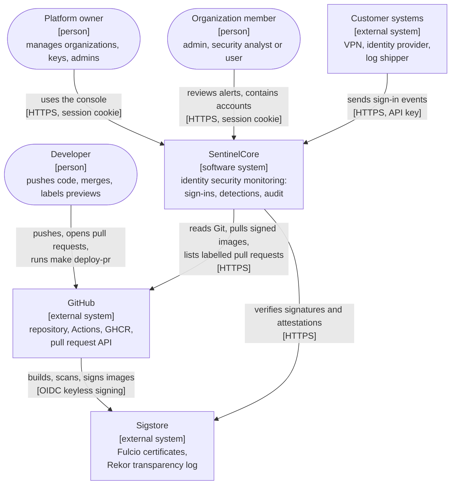
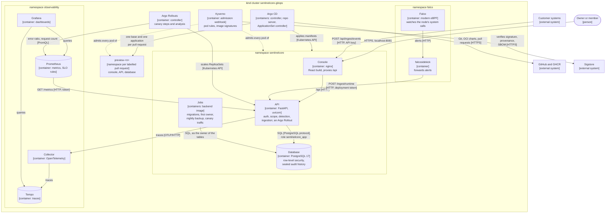

# SentinelCore - Architecture

Two views in the [C4 model](https://c4model.com)'s terms: the **system context** (level 1), who and what SentinelCore works with; and its **containers** (level 2), the separately running parts of the GitOps cluster, the most complete way it runs. The diagrams are Mermaid flowcharts rather than Mermaid's experimental C4 diagrams, which GitHub lays out poorly; each box states its name, its kind and its technology, and each arrow what it carries and how.

The trust boundaries and the data flows are in the threat model's diagrams ([`docs/04-threat-model.md`](04-threat-model.md), §5); the decisions behind this shape are in [`docs/adr/`](adr/README.md). A level 3 view of the API's components is left to [`docs/01`](01-backend-foundation.md) and the code.

## Level 1: system context

| Element | Kind | Role |
|---|---|---|
| Platform owner | Person | The one account outside every organization: creates and suspends organizations, invites their admins, issues ingestion keys, sees the platform's own alerts (Falco, sprays across organizations). |
| Organization member | Person | An admin, security analyst or user of one organization; sees only that organization. |
| Developer | Person | Changes the code through pull requests; a merged deployment pull request is what the GitOps cluster runs. |
| Customer systems | External system | Report their sign-ins to the ingestion API with an expiring key of one organization. |
| GitHub | External system | Holds the code and runs CI, which builds, scans, signs and attests the images and publishes them to GHCR. |
| Sigstore | External system | Issues the short-lived signing certificates and keeps the public log the signatures are checked against. |

## Level 2: containers of the GitOps cluster

**Legend:** rounded boxes are people; rectangles are containers or external systems, with their technology in brackets; cylinders keep data; solid arrows are calls, labelled with what they carry and the protocol; dotted arrows are admission checks. Every namespace of ours denies all traffic but the flows drawn (`network-policies/`, [ADR 0009](adr/0009-default-deny-network.md)); nothing in `sentinelcore` reaches the internet.

| Container | Technology | Responsibility |
|---|---|---|
| Console | nginx (unprivileged), React build | Serves the browser application and passes `/api` to the API, so the browser sees one origin; sends the security headers. |
| API | Python 3.12, FastAPI, SQLAlchemy | Every rule of the product: sessions, organizations and their scope, detection, ingestion, the audit seal. An Argo Rollouts canary of five pods ([`docs/07`](07-gitops.md)). |
| Database | PostgreSQL 17 (StatefulSet) | The records of every organization, kept apart by row-level security; the sealed audit history. |
| Jobs | Backend and PostgreSQL images | Migrations before each version, the first owner, the nightly `pg_dump` and its restore check, the canary's synthetic traffic. |
| Falco, falcosidekick | Falco (modern eBPF), falcosidekick | Runtime detection on the node; four rules reach the API as platform alerts. |
| Collector, Tempo, Prometheus, Grafana | OpenTelemetry, Grafana Tempo, Prometheus, Grafana | Traces of every request and its SQL; the metrics, SLO rules and burn-rate alerts ([`docs/05`](05-slos.md)); the dashboards. |
| Kyverno | Kyverno admission controller | Refuses a pod that breaks the pod rules, or an image of ours not signed and attested by CI. |
| Argo CD | Argo CD, with its ApplicationSet controller | Installs everything from `main`, reverts changes by hand, and makes a preview of each labelled pull request. |
| Argo Rollouts | Argo Rollouts controller | Moves a new API version through its canary steps and stops it when the analysis fails. |
| preview-&lt;n&gt; | The same charts | A pull request's own console, API and database, isolated from `sentinelcore` ([ADR 0012](adr/0012-progressive-delivery-and-previews.md)). |

## The other ways it runs

- **`make up`** (a kind cluster of its own, [README](../README.md#local-kubernetes-cluster)): the same application, Kyverno, network policies, Falco and observability, installed by Helm from the developer's machine. No Argo CD, Argo Rollouts or previews: the API is a plain Deployment of two pods, and the signature policy applies only with `make up FROM=registry`.
- **Docker Compose** (development): PostgreSQL, Prometheus and Grafana only; the API and the console run on the developer's machine. No Kubernetes, so no admission, network policies, Falco or tracing.
